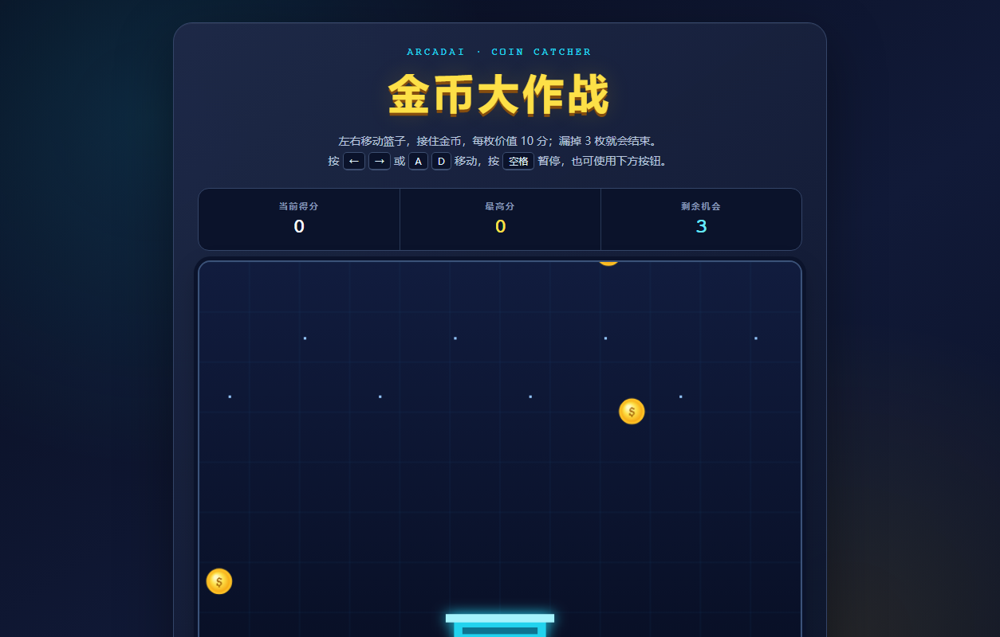

# 金币大作战 — Coin Catcher (ArcadAI)

A small arcade game built for the **ArcadAI** Hack Club workshop: move the basket,
catch falling coins, don't miss three. Written as a single self-contained HTML file
with the Canvas 2D API — no frameworks, no build step, no network requests.



🎮 **Play it:** https://carl-li101008.github.io/arcadai-coin-battle/

## How to play

| Action | Keys | Buttons |
| --- | --- | --- |
| Move basket | `←` `→` or `A` `D` | 「左移」/「右移」 |
| Pause / resume | `Space` | 「暂停游戏」 |
| Start / restart | — | 「开始游戏」/「再玩一次」 |

- Each coin is worth **10 points**; missing 3 coins ends the run.
- The high score is stored in `localStorage`, so it survives a reload.
- Pointer (touch) input works through the on-screen buttons, for phones and tablets.

## What's implemented

- Fixed-timestep game loop with `requestAnimationFrame` and a delta clamp (`0.04s`)
  so a slow frame can't teleport coins through the basket.
- Circle-vs-rectangle collision between coins and the basket.
- Spawning, scoring, lives, game-over and restart state machine
  (`ready → running → paused → over`).
- Pause overlay with the current score, plus auto-pause when the window loses focus.
- `localStorage` high score with a `try/catch` fallback for blocked storage.
- Accessible markup: `<output>` for live stats, `aria-label`s on icon-only controls,
  a keyboard-operable start/restart dialog.

- 每枚金币 10 分，漏掉 3 枚结束；最高分保存在浏览器本地。
- 支持键盘、屏幕按钮（触屏）两种操作方式。

## Run it locally

```bash
node server.js 8126 .     # or: python -m http.server 8126
# open http://127.0.0.1:8126
```

Opening `index.html` directly in a browser also works — there are no dependencies.

## Verified

Tested in headless Chrome over the DevTools Protocol:

- Canvas renders at 720×480, coins and basket are drawn (pixel sampling confirms it)
- 「开始游戏」 starts the loop; score/lives counters update
- Keyboard input moves the basket
- Losing all 3 lives shows the game-over dialog; console errors: **0**

## Built by

Jiaxi Li (@Carl-Li101008) — GCGS Hack Club.

## License

MIT
